## Filtre RC
RC-filter I. rádu. Obvod tvorí rezistor $R$ a kondenzátor $C$. Vstupom je napätie $\mathcal{U}$ zdroja, výstupom je napätie $\mathcal{U}_C$ na kondenzátore.

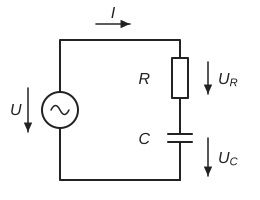{ width="300" }

### Dolnopriepustný filter DPF (LPF)
Hľadáme funkciu, ktorou sa vstupné napätie zmení na výstupné: $\mathcal{U}_C=f_{DPF}(\mathcal{U})$, $\;f_{DPF}=\,?$

$$
\mathcal{U}=\mathcal{U}_C+\mathcal{U}_R=R\,\mathcal{I}+\mathcal{Z}_C\,\mathcal{I}=\underbrace{(R+\mathcal{Z}_C)}_{\mathcal{Z}_{RC}}\,\mathcal{I}=\left(R+\frac{1}{\mathrm{j}\omega C}\right)\mathcal{I}
$$

$$
\mathcal{I}=\frac{\mathcal{U}}{\mathcal{Z}_{RC}}=\mathcal{U}\,\frac{\mathrm{j}\omega C}{1+\mathrm{j}\omega RC}
$$

$$
\mathcal{U}_C=\mathcal{Z}_C\,\mathcal{I}=\frac{1}{\mathrm{j}\omega C}\cdot\frac{\mathrm{j}\omega C}{1+\mathrm{j}\omega RC}\,\mathcal{U}=\underbrace{\frac{1}{1+\mathrm{j}\omega RC}}_{\mathcal{H}_{DPF}(\omega)}\cdot\,\mathcal{U}
$$

$\mathcal{H}_{DPF}(\omega)$ je **prenosová funkcia**.

Tri význačné frekvencie:

- $\omega RC\ll 1$: $\;\mathcal{U}_C\cong\mathcal{U}$
- $\omega RC\gg 1$: $\;\mathcal{U}_C\cong\dfrac{\mathcal{U}}{\mathrm{j}\omega RC}\cong\dfrac{\mathcal{U}}{2\pi f RC}\,e^{-\mathrm{j}\frac{\pi}{2}}$
- $\omega=\dfrac{1}{RC}$: $\;\mathcal{U}_C=\mathcal{U}\,\dfrac{1}{1+\mathrm{j}}=\dfrac{\mathcal{U}}{\sqrt{2}}\,e^{-\mathrm{j}\frac{\pi}{4}}$

Lebo $1+\mathrm{j}=\sqrt{2}\,e^{\mathrm{j}\frac{\pi}{4}}$:

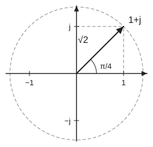{ width="240" }

Graf $\mathcal{H}(\omega)$ v komplexnej rovine: Prenos sa nachádza na polkružnici.

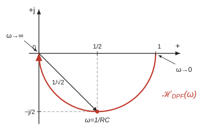{ width="440" }

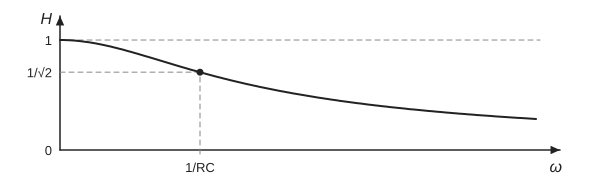{ width="560" }

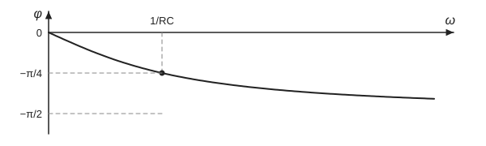{ width="560" }

Frekvenčná charakteristika:

$$
\mathcal{H}(\omega)=\frac{1}{1+\mathrm{j}\omega RC}=H(\omega)\,e^{\mathrm{j}\varphi(\omega)}
$$

$$
H(\omega)=\frac{1}{\sqrt{1+\omega^2R^2C^2}},\qquad
\varphi(\omega)=\arg\left(\frac{1}{1+\mathrm{j}\omega RC}\right)=-\operatorname{arctg}(\omega RC)
$$

### Hornopriepustný filter HPF
Výstupom je napätie na rezistore: $\mathcal{U}_R=f_{HPF}(\mathcal{U})$

$$
\mathcal{U}_R=R\,\mathcal{I}=\underbrace{\frac{\mathrm{j}\omega RC}{1+\mathrm{j}\omega RC}}_{\mathcal{H}_{HPF}(\omega)}\cdot\,\mathcal{U}
$$

Tri význačné frekvencie:

- $\omega\ll\dfrac{1}{RC}$: $\;\mathcal{U}_R=\omega RC\cdot\mathcal{U}\,e^{\mathrm{j}\frac{\pi}{2}}$
- $\omega=\dfrac{1}{RC}$: $\;\mathcal{U}_R=\mathcal{U}\,\dfrac{\mathrm{j}}{1+\mathrm{j}}=\dfrac{\mathcal{U}}{\sqrt{2}}\,e^{+\mathrm{j}\frac{\pi}{4}}$
- $\omega\gg\dfrac{1}{RC}$: $\;\mathcal{U}_R=\mathcal{U}$

$$
\frac{\mathrm{j}}{1+\mathrm{j}}=\frac{1}{1-\mathrm{j}}=\frac{1}{\sqrt{2}\,e^{-\mathrm{j}\frac{\pi}{4}}}=\frac{1}{\sqrt{2}}\,e^{+\mathrm{j}\frac{\pi}{4}}
$$

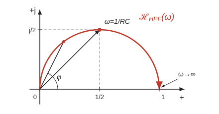{ width="440" }

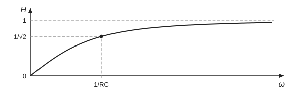{ width="560" }

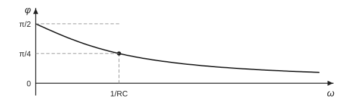{ width="560" }

## Filtre RL
RL-filter I. rádu.

Zadanie: $\mathcal{U}=\mathcal{U}(\omega)=V\,e^{\mathrm{j}\omega t}$; $R$, $L$. Úloha: $\mathcal{U}_L=\,?$

### Hornopriepustný filter HPF
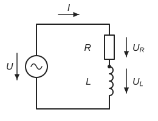{ width="300" }

$$
\mathcal{U}=\mathcal{U}_R+\mathcal{U}_L=R\,\mathcal{I}+\mathcal{Z}_L\,\mathcal{I}=(R+\mathcal{Z}_L)\,\mathcal{I}=\underbrace{(R+\mathrm{j}\omega L)}_{\mathcal{Z}_{RL}}\,\mathcal{I}
$$

$$
\mathcal{I}=\frac{\mathcal{U}}{\mathcal{Z}_{RL}}=\frac{\mathcal{U}}{R+\mathrm{j}\omega L}
$$

$$
\mathcal{U}_L=\mathcal{Z}_L\,\mathcal{I}=\frac{\mathrm{j}\omega L}{R+\mathrm{j}\omega L}\,\mathcal{U}=\underbrace{\frac{\mathrm{j}\omega\frac{L}{R}}{1+\mathrm{j}\omega\frac{L}{R}}}_{\text{prenosová funkcia}}\cdot\,\mathcal{U}=\mathcal{H}_{HPF}\cdot\mathcal{U}
$$

$$
\mathcal{H}_{HPF}(\omega)=\frac{\mathrm{j}\omega\frac{L}{R}}{1+\mathrm{j}\omega\frac{L}{R}}
$$

3 význačné frekvencie:

- $\omega\dfrac{L}{R}\ll 1$: $\;\mathcal{H}(\omega)\cong\mathrm{j}\cdot 0=0\cdot e^{\mathrm{j}\frac{\pi}{2}}$
- $\omega\dfrac{L}{R}\gg 1$: $\;\mathcal{H}(\omega)\cong 1$, $\;\mathcal{U}_L=\mathcal{U}$
- $\omega=\dfrac{R}{L}$: $\;\mathcal{H}(\omega)=\dfrac{\mathrm{j}}{1+\mathrm{j}}=\dfrac{1}{1-\mathrm{j}}=\dfrac{1}{\sqrt{2}\,e^{-\mathrm{j}\frac{\pi}{4}}}=\dfrac{1}{\sqrt{2}}\,e^{\mathrm{j}\frac{\pi}{4}}$

Graf $\mathcal{H}(\omega)$ v komplexnej rovine:

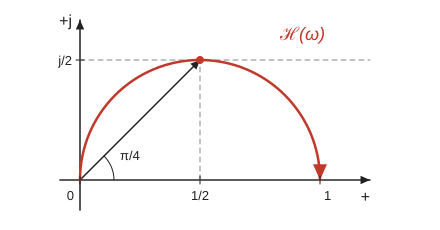{ width="440" }

Frekvenčná charakteristika HPF:

$$
\mathcal{H}(\omega)=\underbrace{H(\omega)}_{\text{AFCH}}\cdot e^{\underbrace{\mathrm{j}\varphi(\omega)}_{\text{FFCH}}}=\frac{\mathrm{j}\omega\frac{L}{R}}{1+\mathrm{j}\omega\frac{L}{R}}
$$

$$
H(\omega)=\left|\frac{1}{1+\frac{1}{\mathrm{j}\omega\frac{L}{R}}}\right|=\frac{1}{\sqrt{1+\dfrac{1}{\omega^2L^2/R^2}}}=\frac{1}{\sqrt{1+\dfrac{R^2}{\omega^2L^2}}}
$$

$$
\varphi(\omega)=\arg\left(\frac{1}{1-\dfrac{\mathrm{j}}{\omega\frac{L}{R}}}\right)=-\arg\left(1-\frac{\mathrm{j}}{\omega\frac{L}{R}}\right)=\operatorname{arctg}\left(\frac{1}{\omega\frac{L}{R}}\right)
$$

{ width="560" }

{ width="560" }

### Dolnopriepustný filter RL (DPF, LPF)
$$
\mathcal{U}_R=R\,\mathcal{I}=\frac{R}{R+\mathrm{j}\omega L}\cdot\mathcal{U}=\frac{1}{1+\mathrm{j}\omega\frac{L}{R}}\cdot\mathcal{U}
$$

$$
\mathcal{H}(\omega)=\frac{1}{1+\mathrm{j}\omega\frac{L}{R}}=H(\omega)\,e^{\mathrm{j}\varphi(\omega)}
$$

$$
H(\omega)=\frac{1}{\sqrt{1+\omega^2L^2/R^2}}\,;\qquad
\varphi(\omega)=\arg\left(\frac{1}{1+\mathrm{j}\omega\frac{L}{R}}\right)=-\operatorname{arctg}\left(\omega\frac{L}{R}\right)
$$

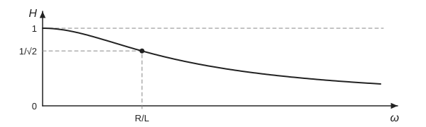{ width="560" }

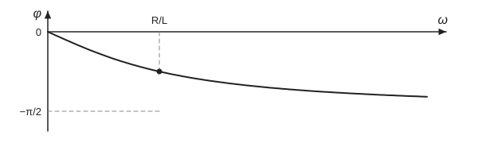{ width="560" }

- $\omega\ll\dfrac{R}{L}$: $\;\mathcal{H}(\omega)=1$
- $\omega=\dfrac{R}{L}$: $\;\mathcal{H}(\omega)=\dfrac{1}{1+\mathrm{j}}=\dfrac{1}{\sqrt{2}}\,e^{-\mathrm{j}\frac{\pi}{4}}$
- $\omega\gg\dfrac{R}{L}$: $\;\mathcal{H}(\omega)\cong\dfrac{1}{\mathrm{j}\omega\frac{L}{R}}=\dfrac{R}{\omega L}\,e^{-\mathrm{j}\frac{\pi}{2}}$

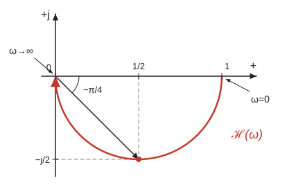{ width="440" }

## Dolnopriepustné filtre RC, LR
## Hornopriepustné filtre CR, RL
