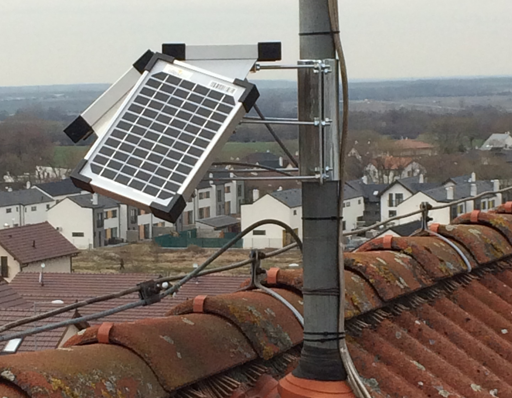
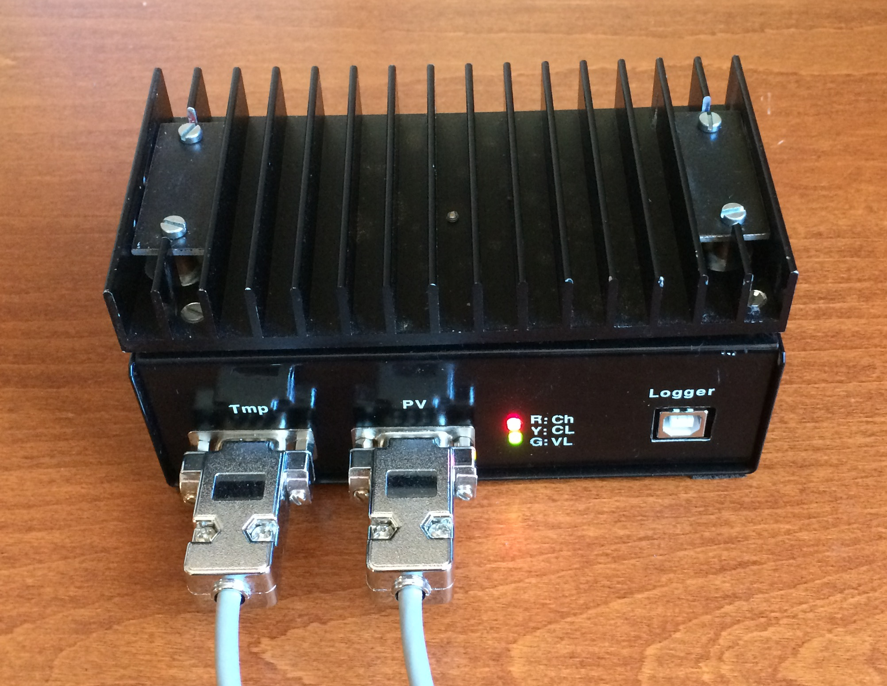
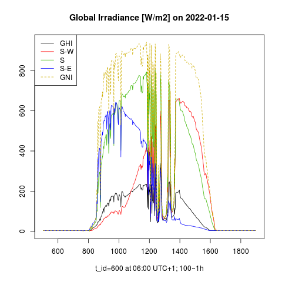
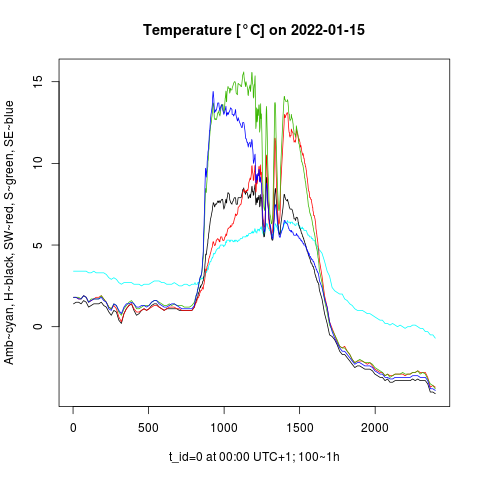

## Measurement of solar global irradiance
***Accurate measurement of global irradiance (GI) is a prerequisite for the analysis of PV smoothing:***  

* Accurate nowcasting of PV power is crucial when shrinking the accumulation of energy by the PV power smoothing. PV power predictors are based on artificial intelligence (AI) and they can be trained by a sky-imagery and by the measured signal GI(t), in particular by its fraction intercepted by a tilted PV panel.
* Having the measured time series GI(t), a low-pass filter (LPF) can be ex-post excited by a simulated "predicted" input signal GI~f~(t+Δt). That is, the measured signal is left-shifted on the time axis and its values are optionally distorted by a simulated predictive error. Given such a "predicted" PV power signal, it is possible to tune the LPF and its RES smoothing in order to meet the given ramping limit of PV power on one side, and to minimize the smoothing costs on the other.

The analysis of PV smoothing puts following demands on the measurement of GI:  

- Capture the whole spectrum of solar intermittency by a sufficiently high sampling frequency
- Measure the fraction of irradiance intercepted by a tilted plane of incidence (PV panel). 
- Respect the physical properties of planar silicon PV panels (reflexion and spectral response)

{ width="300"  align=right }

For general purposes, the momentary solar irradiance has to be measured at any plane of incidence under given atmospheric conditions. Fulfilling all of these demands is not possible only by measuring the global (GHI) and diffused (dHI) horizontal irradiance (both of which are measured by national weather services).

A corresponding measurement system with a data logger has been developed and set up at the author's site (48.2°, 17.1°), and is in operation since 2021/04.

{ width="300"  align=right }

 The system consists of 2 units:

1. external console carrying 4 reference PV panels at different angles, with temperature sensors sticked at rear sides of PV panels,
2. internal measurement unit serving as a MPPT controller, A/D converter of measured PV power and temperature, data logger, backup battery, PV charger, and heat sink.

## System features

* The reference monocrystaline silicon PV panels (sensors) are calibrated by means of 
[Ineichen/Perez clear-sky model](https://pvlib-python.readthedocs.io/en/v0.4.3/generated/pvlib.clearsky.ineichen.html)
, having its 
[Linke-turbidity factor](https://glossary.ametsoc.org/wiki/Linke_turbidity_factor)
 calibrated by the reference GHI, dHI measured by a near meteorological site. The panels are re-calibrated on a regular basis.
* The panels are always operated at their
[maximum output power (MPPT)](https://www.leonics.com/support/article2_14j/articles2_14j_en.php)
. Their optimum operating point is dynamically adjusted for insolation and surface temperature (drift of their V-A characteristic). The measured output power of each panel is divided by its active surface area and by its (known) efficiency at given temperature. The result is eventually expressed as a "photovoltaic global irradiance" in W/m^2^, analogous to the global irradiance measured at corresponding incidence angle, but taking into account the light reflexion and spectral response of PV panels.
* Built-in data logger samples the GI values with a dynamic sampling period varying from 0.5 second to 10 minutes, depending on the momentary solar intermittency. The whole spectrum of solar intermittency is thus recorded without redundancy. Several years of such an irregular time series occupy <1GB of memory.
* In addition to measurement, the PV sensors supply power to the data logger and charge its backup battery. This off-grid measurement system is self-powered 24 hours x 7 days a week and requires a minimal maintenance.
* Simultaneous GI measurement from 4 PV panels with size 20 cm x 16 cm at different angles allows accurate interpolation of GI at **any plane of incidence** assuming that the direct beam points among the 4 panels' normal vectors (intra-normal area). The signal GI(t) from the south-oriented panel is supplied for the numeric simulation of PV power smoothing. The south panel's normal vector is elevated by 47°. (This panel is further refered to as PV2.)
  
{ width="300" align=right }
   
Daily (12 h) profiles of photovoltaic GI [W/m2] measured at four different planes of incidence. GHI corresponds to the horizontal plane, whereas the extrapolated GNI corresponds to a virtually solar-tracked normal plane of incidence. The normal vector of GNI plane points to an extra-normal area in winter when the solar elevation is lower than the elevation of the panels' normal vectors. Since the extrapolated GNI is less accurate than the interpolated one, GNI may be less accurate in winter.
   
{ width="300" align=right }
   
Daily (24 h) temperature profiles at four PV surfaces, and ambient temperature (cyan color).
The PV surface's temperature is mainly affected by the ambient temperature, solar irradiation, and by wind. Since the panel temperature is higher than the sky temperature, the PV panels are always cooled by their own thermal radiation. This effect can be observed at the night when the panels are not exposed to the solar radiation.
